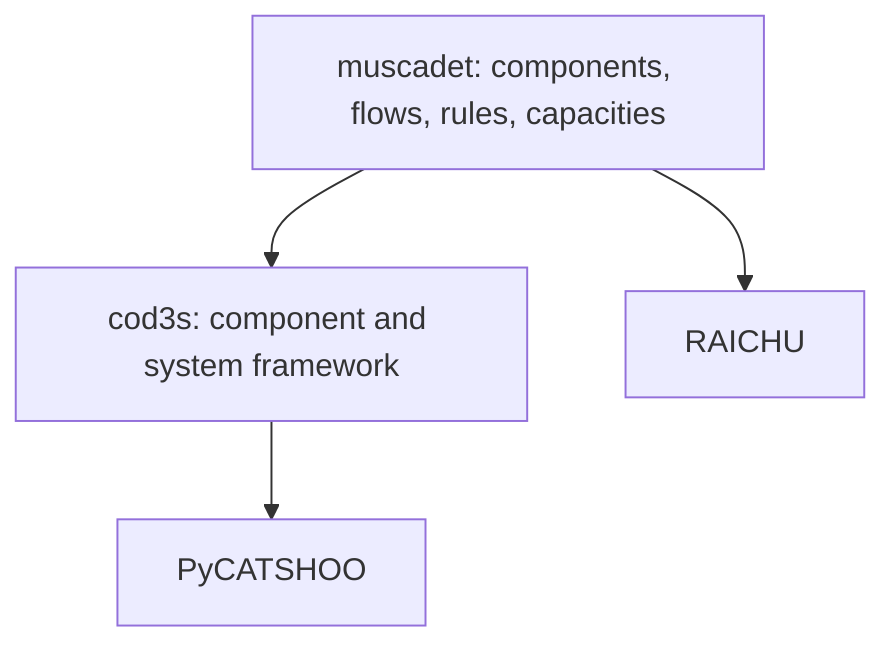

# muscadet

muscadet (*Modélisation de flUx StoChAstiques DiscrETs*) is a Python library
for modelling systems that propagate flows: electricity, water, heat, signals,
information. A model mirrors the physical architecture of the system it
represents. Each component declares the flows it receives and produces, the
failures that interrupt them, and the volumes that buffer them. The library
derives the propagation from the connections.

Two flow families coexist in one model:

| Family | Carries | Combined by |
|---|---|---|
| Discrete | a boolean: fed or not fed | `and`, `or`, k-out-of-n logic |
| Continuous | a real rate integrated over time | transformation rules, capacities, allocation policies |

A model is simulated by Monte Carlo on a piecewise deterministic Markov process
(PDMP) engine. Two engines are available: PyCATSHOO, developed by EDF R&D, and
RAICHU, developed by EdgeMind.

## Where to start

| You want to | Read |
|---|---|
| install the library | [Installation](installation.md) |
| build and simulate a first model | [Getting started](getting-started.md) |
| look up a class or a method | [API reference](reference/index.md) |
| know what changed in a release | [Changelog](changelog.md) |

The [README](https://github.com/edgemind-sas/muscadet#readme) documents every
continuous-flow mechanism in depth: rules, capacities, allocation, profiles,
transfer pairs, mixtures and controllers.
